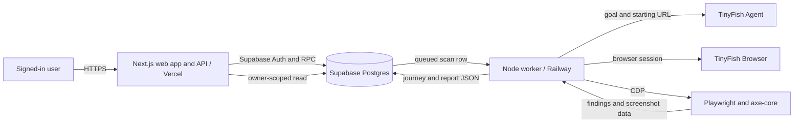
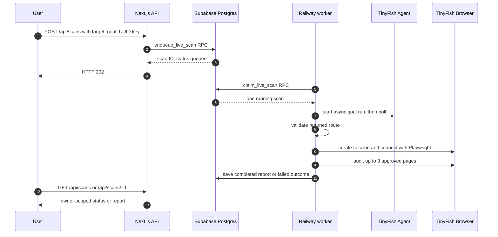

# AccessPath architecture

**Status:** implementation-aligned technical documentation for review
**Reviewed against repository:** 18 October 2026
**Project:** AccessPath, AZINHACK 2026

> This document describes the prototype that is present in the repository, plus clearly labelled next steps. It does not imply that an automated audit certifies WCAG conformance. Runtime configuration in Supabase and hosting platforms may change independently of the checked-in code.

## 1. Overview

AccessPath starts with an approved public website and a visitor goal. A TinyFish Agent follows the goal and returns a short route. A separate TinyFish Browser session lets the worker revisit approved pages with Playwright, run axe-core, and capture viewport screenshots. The journey and audit are saved to the signed-in user's private report library.

The live preview currently supports two starting targets: the Northstar controlled demo and the team's public GitHub repository. The user can write a goal of 12-180 characters, but cannot supply an arbitrary website. The agent is instructed to remain in the approved public area, visit at most three pages, and avoid logging in, submitting forms, buying anything, or changing data.

There is also a separate import path for a previously exported controlled-demo audit JSON. Importing does not start TinyFish or consume a live-scan attempt.

### What the product does not claim

- An axe-core result is an automated rule check, not full WCAG conformance.
- A completed report is not proof that every visitor can finish the task.
- The worker's production operation has been demonstrated on the controlled site and the approved GitHub target, but load, reliability and cost benchmarks have not been published.

## 2. System context



The web tier enqueues and reads scans; it does not perform the live browser audit inside the request. The worker and web tier communicate through Supabase rows and database functions, not a direct worker HTTP endpoint. The worker is a continuously polling process.

### Components and responsibilities

| Component | Current implementation | Responsibility |
| --- | --- | --- |
| Web | Next.js App Router, React, TypeScript, CSS Modules on Vercel | Sign-in, dashboard, target/goal form, report UI, authenticated scan API |
| Data and identity | Supabase Auth and PostgreSQL | Sessions, owner-scoped scan rows, queue and preview limits |
| Worker | Node.js/TypeScript on Railway | Claim one queued job, discover route, run audit, save outcome |
| Journey | TinyFish Agent async API | Goal-led route discovery and structured steps |
| Audit browser | TinyFish Browser + Playwright Core over CDP | Revisit approved URLs, run checks, capture screenshots |
| Rules | axe-core 4.14.0 | WCAG 2.0/2.1 A/AA-tagged automated findings |
| Package management | pnpm workspace | Web and worker packages with a shared lockfile |

The worker package permits Node 20 or newer. The repository's local setup recommends Node 24. This is not a claim that every deployment runs the same Node version.

## 3. Trust boundaries and access control

1. **User browser to web API:** The browser is untrusted. The scan POST requires a signed-in account, same-origin request, JSON content type, a UUID idempotency key, a body under 4 KB, an approved exact starting URL, and a bounded goal.
2. **Web API to Supabase:** The browser session is used for authenticated reads and `enqueue_live_scan`. The database function independently checks the target, account invitation, queue pause switch, one-active-scan rule, shared budgets, and idempotency.
3. **Worker to providers:** The Railway worker holds server-side Supabase and TinyFish credentials. They must not be put in `NEXT_PUBLIC_*` variables, committed to Git, or included in screenshots.
4. **Agent and target website:** Returned URLs are treated as untrusted data. The worker revalidates the route against target-specific HTTPS origin and path rules before auditing. This is an allowlist, not a generic arbitrary-URL or full-network SSRF defense.
5. **Reports back to users:** The `scans` table has row-level security and an owner-only SELECT policy. The scan list and detail API require sign-in and return private, non-cacheable responses.

For the approved targets, the URL policy rejects other origins, credentials, query strings, and paths outside the defined Northstar or repository route. Redirected audit pages must land at the exact approved URL; otherwise the scan fails. The worker also redacts provider URLs and common secret formats from diagnostic log messages. These are code-level controls, not an independent security assessment.

### Secret placement

| Environment | Values |
| --- | --- |
| Web client | Supabase project URL and publishable key; the live-preview UI flag |
| Web server | Supabase server-side session handling and private journey-preview settings where configured |
| Railway worker | `SUPABASE_URL`, `SUPABASE_SECRET_KEY`, `TINYFISH_API_KEY`, `ACCESSPATH_WORKER_ENABLED=true` |

The worker must receive a Supabase secret/service credential with permission to call the restricted claim function. A publishable key cannot serve this role.

## 4. Scan request and queue lifecycle



The database claim function uses `FOR UPDATE SKIP LOCKED` so concurrent workers do not claim the same queued row. A claim changes its status to `running` and sets `started_at`. There is **no lease heartbeat, automatic requeue, attempt counter, or dead-letter queue** in the current worker. This is intentional for the paid preview: a crash after the provider starts must not silently trigger a second paid run. An operator must inspect a stuck `running` row before changing it.

The dashboard refreshes its scan list while it sees a queued or running item. A fresh POST with the same account and idempotency key returns the existing live scan ID. The app allows one active queued/running scan per user.

### Current state behavior

| State | Meaning in current flow |
| --- | --- |
| `queued` | Accepted by the database function and waiting for the worker. |
| `running` | Claimed once by the worker. A worker crash can leave this state for manual review. |
| `completed` | Journey and automated audit report saved successfully. |
| `failed` | No completed audit report was saved; a bounded failure code is recorded. |
| `cancelled` | Supported by the database status vocabulary and budget accounting for never-started rows; there is no public cancellation endpoint in the current app. |
| `partial` | Allowed by the schema and report UI, but the live worker does not currently produce it. |

Do not describe `partial`, running-scan cancellation, leases, or automatic retries as shipped features.

## 5. Journey and audit pipeline

### 5.1 Discover the route

The worker calls TinyFish Agent's asynchronous endpoint with the approved start URL, the user's goal, navigation restrictions, and a structured output schema. The provider configuration requests a maximum agent duration of 90 seconds. The worker polls up to 80 times at three-second intervals, allowing extra time for startup and result finalization. If the run fails, is cancelled, times out in the polling window, or returns an invalid shape, the scan fails. The worker does not currently issue a provider-side cancellation on timeout.

The schema permits up to six recorded steps, but the task prompt asks the agent to visit at most three pages. The audit uses at most the first three unique approved URLs from a completed journey. A `not_found` or `blocked` outcome yields a failed scan with no report; it is not presented as a pass.

### 5.2 Validate the route

Each returned step must have a title, URL, action, and observation. The worker checks every URL against the selected target's policy. The Northstar policy is confined to its demo routes; the GitHub policy is confined to the team's public repository pages and files on the `main` branch. Invalid journey data fails the scan rather than silently dropping entries.

### 5.3 Run browser checks

The worker starts one TinyFish Browser session, connects Playwright to its CDP URL, and uses the existing page in the provider's browser context. For every approved URL it:

1. Navigates with a 30-second page timeout and requires a successful response at the exact approved URL.
2. Allows axe-core injection in the browser page, including pages with restrictive Content Security Policy.
3. Runs axe-core rules tagged `wcag2a`, `wcag2aa`, `wcag21a`, and `wcag21aa`.
4. Keeps rule ID, impact, help text, help URL, affected-node count and up to five target selectors per rule; it also records counts for incomplete and passed rule checks.
5. Captures a viewport JPEG screenshot. A screenshot over 350 KB is omitted rather than making the report too large.

The worker puts the resulting page array and note into a report. Before saving, it may remove the largest screenshot previews until the serialized report fits below approximately 850 KB; the database enforces a 1 MB JSON report limit. Screenshots are embedded as data URLs in report JSON, **not** uploaded to a private Supabase Storage bucket. There is no signed-link evidence service in the current implementation.

The worker closes Playwright and requests TinyFish session deletion in a `finally` block. It logs cleanup failure; it does not currently retry deletion. Any page-load, injection, audit, or screenshot exception fails the whole live scan. Earlier page results are not stored as a partial live report.

### 5.4 Interpret the report

The report contains automated findings and counts of rules needing review. A human must validate findings and test keyboard operation, focus order, assistive technology behavior, and whether the visitor can actually complete the task. The public Northstar comparison demonstrates a confirmed missing email-field label and a corrected version; it does not establish whole-site conformance.

## 6. Data model and API surface

The current database is centered on **one `public.scans` table**, not five normalized scan tables. Each row includes the owner ID, source (`imported` or `live`), target URL, task, status, report JSON, journey JSON, idempotency key, timestamps and optional failure code. The live preview also has `live_scan_limits` and `live_scan_access` tables. Those control the paused switch, shared attempt budgets, and invited accounts.

| Endpoint | Purpose |
| --- | --- |
| `GET /api/scans` | Recent owner-visible scan metadata (up to 30 rows). |
| `POST /api/scans` | Enqueue an approved live scan; returns HTTP 202 with ID and queued status. |
| `GET /api/scans/:id` | Owner-visible journey and report for a scan ID. |
| `POST /api/scans/import` | Save a validated controlled-demo JSON export without a live provider run. |

The scan ID is not an authorization token: the API uses the signed-in Supabase session, and RLS enforces owner-only reads. The web API does not expose the worker's claim function. The current report JSON embeds any retained screenshot data directly, so private report responses can be large.

## 7. Limits and paid-preview controls

- The web feature flag and database `live_scan_limits.enabled` both affect whether users can start live scans. Database migrations leave the queue paused; an operator explicitly enables it after checking deployment and budget.
- Exact starting URLs are restricted to the two approved public targets. Audit routes are further restricted by target-specific path rules.
- One account can have one queued or running scan. The queue's shared UTC-day and lifetime caps are database values, not hard-coded per-user daily limits in the latest enqueue function.
- The latest checked-in budget migrations set shared floors of **six attempts per UTC day** and **twelve lifetime attempts**. They do not reveal the current production values; an operator can change them in Supabase.
- A queued scan cancelled before it starts is excluded from shared attempt counting. There is no public cancellation control in the current web app.
- One worker process handles one claimed scan at a time. The code does not enforce a global browser-session cap across multiple worker replicas or a per-domain active-scan cap.
- The worker requests a browser session timeout of 180 seconds, caps audits at three pages, limits screenshots and report JSON size, and does not launch a second run automatically after failure.

This is an attempt budget, **not a measured currency spend cap**. TinyFish charges, total scan duration, and completion rate need operational measurement.

## 8. Failure handling and operations

| Failure | Current behavior |
| --- | --- |
| Invalid target, goal or request format | The web API rejects the request before enqueue. The database function rechecks core rules. |
| Queue paused, user not invited, active scan or shared cap reached | Database function rejects enqueue; API maps known codes to user-facing errors. |
| Agent timeout, failure, blocked task or invalid returned route | Worker stores `failed` with a reason code; no audit report is shown as a pass. |
| Browser connection, navigation, CSP/injection, axe or screenshot failure | Whole live scan becomes `failed`; stage detail is logged with sensitive strings redacted. |
| Browser session deletion failure | Worker logs a warning; an operator should check the TinyFish dashboard for any orphaned session. |
| Worker dies after claiming | Scan may remain `running`; do not blindly reset it because the provider may already have charged for work. |
| Supabase outcome update fails | Worker logs that the scan needs manual database review. |

Recommended operator runbook: confirm the Railway deployment is active; inspect stage-specific logs without exposing keys; compare the scan row's `status`, `started_at`, and `failure_code`; inspect provider activity if available; decide manually whether a new paid attempt is warranted. Pause the queue in `live_scan_limits` before changing worker or database behavior.

## 9. Scalability and trade-offs

Database row claims keep the queue simple and prevent two workers from claiming the same queued row at once. Separating short web requests from browser work avoids holding an HTTP request open during an agent/browser run. The current implementation is appropriate for a tightly controlled preview, but is **not** a verified high-throughput multi-worker service.

Important trade-offs:

- Agent and audit browser sessions are separate. The auditor revisits URLs; it does not replay the exact interaction state. Dynamic or session-dependent pages may differ.
- A single failure fails the live report. Partial page persistence, resumability, and automatic repair are future work.
- Keeping screenshots inside JSON simplifies the prototype but increases row/response size and can force screenshots to be dropped.
- The no-automatic-retry design avoids accidental duplicate provider charges but requires manual recovery after a worker crash.
- Narrow target allowlists reduce abuse and simplify permissions but limit general-purpose coverage.

Before claiming scale, measure scan completion rate, median/p95 duration, cost per completed report, provider cleanup success, database claim contention, and performance with more than one worker.

## 10. Repository map and checks

```text
apps/web/                 Next.js UI, report pages and API routes
apps/web/src/lib/         Supabase helpers and approved target list
apps/worker/src/          Queue loop, target policy, TinyFish and audit code
supabase/migrations/      Scan schema, RLS, functions and preview budgets
docs/                     Controlled fixture and audit-validation notes
docs/assets/              README and report screenshots/graphics
```

There is currently **no** `packages/contracts` package, separate `demo-site/` directory, `supabase/tests/rls.sql`, or `.github/workflows/ci.yml` in the inspected repository. The demo site lives in the web app. Existing checks include the web production build, worker TypeScript check, and worker TinyFish tests:

```powershell
pnpm --filter ./apps/web build
pnpm --filter @accesspath/worker check
pnpm --filter @accesspath/worker test
```

The team also reported a successful private-account isolation check and completed live Northstar and GitHub scans. Those operational checks are not a substitute for a committed automated CI suite.

## 11. Implementation status and next steps

| Capability | Current status | Evidence or limitation |
| --- | --- | --- |
| Owner-scoped saved reports | Implemented and team-tested | Auth + RLS in migration; team-reported privacy tests. |
| Live Northstar scan | Team-verified | Three-page route and saved report; confirmed email-label finding. |
| Approved GitHub scan | Team-verified | Team reported a completed run and opened report. |
| Async Agent + Browser + axe-core pipeline | Implemented and exercised | Worker code plus completed live reports. |
| `FOR UPDATE SKIP LOCKED` claim | Implemented | Database function; no load test across multiple replicas. |
| Shared attempt caps and pause switch | Implemented | Database functions and migrations; production values must be checked in Supabase. |
| Private Storage screenshots and signed URLs | Planned | Current screenshots are optional data URLs in report JSON. |
| Lease heartbeat and automatic retry | Not implemented | Manual review avoids duplicate paid work. |
| Partial live reports and owner cancellation UI | Not implemented | Statuses exist in schema, but worker/UI flows do not produce them. |
| Automated CI and load testing | Not demonstrated | Add only after meaningful tests and a repeatable fixture. |

Near-term work: document the operational runbook; add safe provider-session cleanup monitoring; capture repeated run metrics; improve failure reporting and a deliberate recovery flow; move evidence to private object storage if report size becomes a practical limit; add user testing and manual accessibility review. Do not label these as shipped until implemented and verified.

## 12. References

- [Repository README](../README.md)
- [Controlled demo fixture](./demo-fixture.md)
- [Demo audit validation](./demo-audit-validation.md)
- [Supabase migrations](../supabase/migrations/)
- [TinyFish Agent documentation](https://docs.tinyfish.ai/)
- [axe-core documentation](https://www.deque.com/axe/core-documentation/api-documentation/)
- [W3C WAI: Selecting evaluation tools](https://www.w3.org/WAI/test-evaluate/tools/selecting/)

**Documentation note:** The source draft linked to `DATA-AND-API.md`, `SECURITY.md`, `TINYFISH-PIPELINE.md`, and `SETUP-AND-DEPLOYMENT.md`. Those files were not present in the inspected repository. Add cross-links only when those documents exist and have been reviewed.

## 13. Maintainer verification checklist

Use this checklist when the architecture or deployment changes. It records what to inspect; completing it does not by itself constitute a security or accessibility certification.

- Confirm the web and worker deployments are built from the same intended commit and that the worker starts with the expected environment variables.
- Confirm the actual `live_scan_limits` row before quoting any queue status or budget. Migrations often leave `enabled = false`, and an operator can change production values later.
- Check the web target list, worker route policy, and database `enqueue_live_scan` target list together. A mismatch can accept a request that the worker later rejects, or hide a valid target in the UI.
- Re-run a controlled Northstar goal and verify the status sequence, route, page count, finding, screenshot handling, and owner-only report view.
- Test a second account's inability to read the first account's scan through both the UI and the detail API. Do not use real credentials in documentation screenshots.
- If changing browser behavior, verify a restrictive-CSP target, final URL checks, session cleanup, and a failed-run path without automatically spending another provider attempt.
- If adding Storage or signed evidence links, update the data model, retention rules, access-control tests, and this document at the same time.
- If adding CI, record the exact workflow file and meaningful checks here only after they run successfully in the repository.

### Code locations to revisit

| Topic | Current source of truth |
| --- | --- |
| Enqueue validation and response | `apps/web/src/app/api/scans/route.ts` |
| Owner-scoped report read | `apps/web/src/app/api/scans/[id]/route.ts` |
| UI target choices | `apps/web/src/lib/scan-targets.ts` |
| Worker claim, status write and failure logs | `apps/worker/src/index.ts` |
| Agent goal and journey parsing | `apps/worker/src/tinyfish.ts` |
| Approved audit routes | `apps/worker/src/targets.ts` |
| Browser and axe-core work | `apps/worker/src/audit.ts` |
| Scan schema, RLS and budget functions | `supabase/migrations/` |
