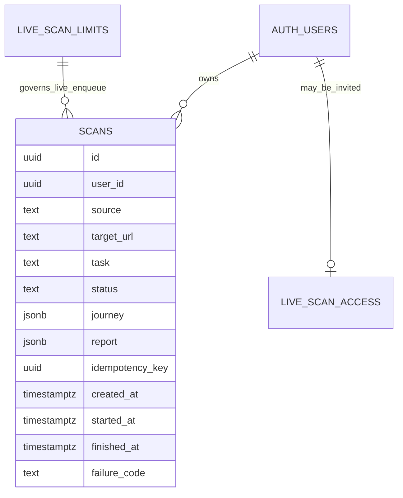
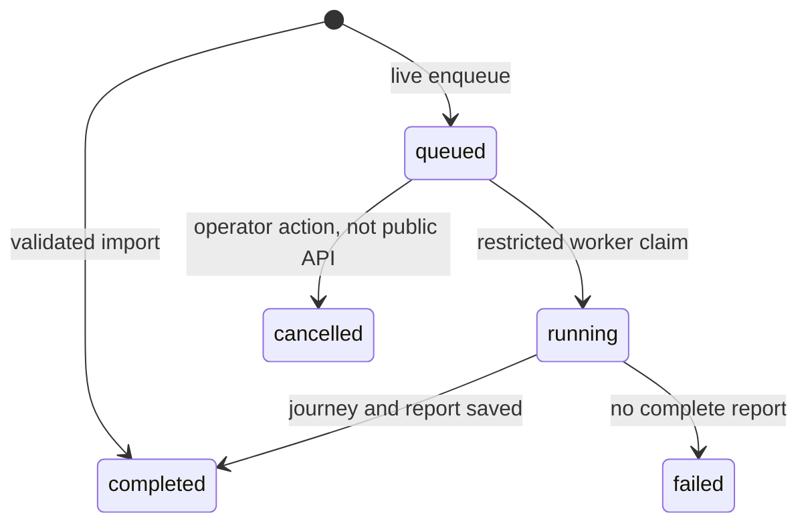

# Data model and API

**Status:** implementation-aligned technical documentation for review
**Reviewed against repository:** 18 October 2026
**Project:** AccessPath, AZINHACK 2026

> This document describes the checked-in schema and scan API. Production database values may differ from migration defaults after operator changes. Examples use synthetic IDs and shortened report objects; consult the API route and migration code before treating an example as a complete schema.

## 1. Scope and principles

AccessPath has two ways to save evidence: import a validated controlled-demo audit JSON, or enqueue a paid live scan for an approved public target. The Next.js handlers authenticate, validate, call Supabase database functions, and return promptly. The Railway worker handles live Agent and Browser work outside the HTTP request.

The current database model is deliberately compact. **One `public.scans` table** stores both imported and live scan metadata, journey JSON, and report JSON. Two additional tables control the invite-only live preview: `public.live_scan_limits` and `public.live_scan_access`. There are no separate `scan_steps`, `findings`, `artifacts`, or `usage_daily` tables in this release.

Owner privacy depends on the signed-in Supabase session and the `scans` Row Level Security (RLS) policy. A scan ID alone never authorizes a read. The database functions enforce write rules and shared budgets so simultaneous web requests cannot bypass them.

## 2. Data relationships



`AUTH_USERS` represents Supabase Auth users, not a custom application table. `LIVE_SCAN_LIMITS` is a singleton configuration table, not a per-scan foreign-key parent; the diagram shows the operational dependency. Route steps and page findings are nested in JSON fields rather than normalized into child rows.

## 3. Tables and constraints

### 3.1 `public.scans`

| Column | Current purpose |
| --- | --- |
| `id uuid` | Primary key returned to the client. |
| `user_id uuid` | Owner, referencing `auth.users(id)` with cascade deletion. |
| `source text` | `imported` or `live`. |
| `target_url text` | Starting target URL; 12-2048 characters by database constraint. |
| `task text` | Visitor goal; 12-180 characters. |
| `status text` | One of `queued`, `running`, `completed`, `partial`, `failed`, `cancelled`. |
| `report jsonb` | Automated audit report, maximum 1 MB as database JSON text. Required for `completed` or `partial`; absent for other states. |
| `journey jsonb` | Structured live Agent result; maximum 30 KB. |
| `idempotency_key uuid` | Client-generated UUID, unique with `user_id`. |
| `created_at`, `started_at`, `finished_at` | Lifecycle timestamps. `started_at` was added with the live queue. |
| `failure_code text` | Short worker reason, maximum 80 characters. The owner-scoped scan list returns only known values; the UI maps them to bounded guidance and never displays raw exception text. |

The schema permits `partial` and `cancelled`, but the current live worker writes only `completed` or `failed`. The application has no public cancellation endpoint. A queued row can be changed by an operator in the database; never assume that a schema enum means the corresponding user flow is implemented.

### 3.2 `public.live_scan_limits`

One row identified by `singleton = true` holds `enabled`, `daily_global_cap`, and `lifetime_global_cap`. The claim function also reads `enabled`, so pausing the queue stops new claims as well as new submissions. The latest checked-in budget migrations raised the daily and lifetime **minimum configured values** to six and twelve; actual production values and enabled state must be read from Supabase. These counters track admitted paid attempts, not money spent.

### 3.3 `public.live_scan_access`

`user_id` is the primary key and references Supabase Auth; `granted_at` records when an account was invited. The live enqueue function requires a row for the signed-in user. This table and the limits table are not client-readable through the normal authenticated role.

## 4. Indexes and access policies

| Database object | Purpose |
| --- | --- |
| `scans_user_idempotency_idx` | Unique `(user_id, idempotency_key)` to prevent duplicate rows for one owner/key. |
| `scans_user_created_idx` | Owner's history ordered by newest creation time and ID. |
| `scans_one_active_user_idx` | Unique active (`queued` or `running`) row per owner. |
| `scans_live_queue_idx` | Partial index for live queued rows ordered by creation time and ID. |

RLS is enabled on `scans`. The authenticated role has SELECT, with an owner-only policy using `auth.uid() = user_id`. The normal client does not receive direct INSERT/UPDATE rights for scans. It writes through narrowly granted security-definer functions: `save_imported_audit` or `enqueue_live_scan`. The worker's Supabase secret/service credential can call the restricted `claim_live_scan` function and update the running scan. Keep that credential only in the worker environment.

RLS is also enabled on the preview-control tables. Their normal `anon` and `authenticated` privileges are revoked, so callers do not read or change the invite list and budget switch directly. Do not claim a committed `supabase/tests/rls.sql` file exists: the team reported manual two-account isolation tests, but that automated test file is not in the inspected repository.

## 5. Database functions and state transitions

### Imported audit

`save_imported_audit(target_url, task, report, idempotency_key)` authenticates the caller through `auth.uid()`, checks the controlled-demo URL, task length, report shape and size, and limits imports to ten per owner per UTC day. It stores a `completed` row with `source = 'imported'`. Importing uses no TinyFish credits.

### Live enqueue

`enqueue_live_scan(target_url, task, idempotency_key)` checks authentication, the exact approved starting URL, task length, invitation, pause state, one-active-scan rule, and shared UTC-day/lifetime budgets. A transaction-wide advisory lock serializes admission checks and insertions. A never-started cancelled live row is excluded from shared attempt counts. The current function has **no per-account daily scan cap**, though one active scan per account remains.

An idempotent retry with the same owner and key returns the previous live scan ID before consuming another attempt. The function does not compare the retry's request body with the original body; clients must not reuse keys for different requests.

### Live claim and finish

`claim_live_scan()` requires the service role, checks the queue switch, selects the oldest live queued row with `FOR UPDATE SKIP LOCKED`, changes it to `running`, sets `started_at`, and returns its ID, target and task. It claims a row once; there are **no leases, attempt counters, heartbeats, or automatic requeues**. After processing, the worker updates the row to `completed` with journey/report or `failed` with a failure code and timestamp. A worker crash can leave a row `running` for manual review.



The schema also accepts `partial`, and the dashboard can link a partial row to its report, but the current live worker does not produce one. A cancelled queued row is meaningful for shared-budget accounting; running cancellation is not implemented as a user feature.

## 6. API conventions

The shipped scan endpoints return JSON with `Cache-Control: private, no-store`. They require a configured Supabase project and authenticated session. POST routes require same-origin requests and `Content-Type: application/json`. They check the `Idempotency-Key` header for UUID syntax and read bounded request bodies.

The API uses direct `{ "error": "Human-readable message" }` error objects, **not** a nested `{ "error": { "code", "message" } }` contract. There is no shared Zod contracts package in the current repository. The handlers use TypeScript checks plus route-specific runtime validation, and the database functions recheck critical write rules.

| Shipped endpoint | Access | Purpose |
| --- | --- | --- |
| `GET /api/scans` | Signed-in | Return up to 30 recent owner-visible scan metadata rows. |
| `POST /api/scans` | Signed-in and invited for live preview | Queue an approved live scan; HTTP 202. |
| `GET /api/scans/:id` | Signed-in owner | Return one scan including `journey` and `report`; 404 when absent or not visible. |
| `POST /api/scans/import` | Signed-in | Save a valid controlled-demo audit; HTTP 201. |

`POST /api/scans/:id/cancel` and `GET /api/health` do **not** exist in the inspected app. The other private `/api/journeys` and local-only `/api/audits` routes serve a separate preview and are not the persisted scan API.

## 7. Request and response examples

All UUIDs below are synthetic. Shapes reflect the current handlers; report internals are abbreviated for readability.

### 7.1 Queue a live scan

```http
POST /api/scans
Content-Type: application/json
Idempotency-Key: 11111111-1111-4111-8111-111111111111
```

```json
{
  "targetUrl": "https://access-path-mu.vercel.app/demo-site",
  "task": "Find the contact form through the support page."
}
```

The body must be under 4 KB. `targetUrl` must be one of the exact approved values in the web target list and database function; `task` is normalized by trimming and collapsing whitespace and must be 12-180 characters. The feature flag can return 503 before any provider work starts.

HTTP 202 response:

```json
{"id":"11111111-1111-4111-8111-111111111111","status":"queued"}
```

### 7.2 List scans

`GET /api/scans` returns HTTP 200:

```json
{
  "scans": [
    {
      "id": "11111111-1111-4111-8111-111111111111",
      "source": "live",
      "target_url": "https://access-path-mu.vercel.app/demo-site",
      "task": "Find the contact form through the support page.",
      "status": "completed",
      "created_at": "2026-10-18T09:30:00Z",
      "finished_at": "2026-10-18T09:33:00Z"
    }
  ]
}
```

The handler orders newest first and limits the response to 30 rows. It does **not** accept `cursor` or `limit` parameters, and it does not return `nextCursor`.

### 7.3 Read one scan

`GET /api/scans/11111111-1111-4111-8111-111111111111` returns HTTP 200:

```json
{
  "scan": {
    "id": "11111111-1111-4111-8111-111111111111",
    "source": "live",
    "target_url": "https://access-path-mu.vercel.app/demo-site",
    "task": "Find the contact form through the support page.",
    "status": "completed",
    "report": {
      "checkedAt": "2026-10-18T09:32:59Z",
      "pages": [{
        "url": "https://access-path-mu.vercel.app/demo-site",
        "title": "Demo home",
        "violations": [],
        "needsReviewCount": 0,
        "passedRuleCount": 0,
        "screenshot": null
      }],
      "note": "Synthetic example only"
    },
    "journey": {
      "outcome": "completed",
      "summary": "Synthetic example only",
      "steps": [{
        "title": "Demo home",
        "url": "https://access-path-mu.vercel.app/demo-site",
        "action": "Opened the approved start page",
        "observation": "Public navigation was visible"
      }]
    },
    "created_at": "2026-10-18T09:30:00Z",
    "finished_at": "2026-10-18T09:33:00Z"
  }
}
```

In a real completed scan, `report.pages` contains one to three audited page objects and `journey.steps` contains the recorded route. The values above are synthetic and do not represent measured findings. The current endpoint does not return a separate `findings` array, signed evidence links, or `failure_code`.

### 7.4 Import a controlled-demo audit

```http
POST /api/scans/import
Content-Type: application/json
Idempotency-Key: 22222222-2222-4222-8222-222222222222
```

```json
{
  "task": "Review the controlled contact page.",
  "report": {
    "checkedAt": "2026-10-18T09:00:00Z",
    "pages": [{
      "url": "https://access-path-mu.vercel.app/demo-site/contact",
      "title": "Contact",
      "violations": [],
      "needsReviewCount": 0,
      "passedRuleCount": 0,
      "screenshot": null
    }],
    "note": "Synthetic example only"
  }
}
```

The real validator requires one to three complete page objects, approved Northstar URLs, bounded violation data, valid counts and optional JPEG data URLs. The synthetic zero counts above are **not** a statement about the real Contact page. The request body must be under 800 KB. The database function allows up to ten imported reports per owner per UTC day. Successful response: HTTP 201 `{ "id": "..." }`.

## 8. Errors and privacy behavior

| Status | Current examples |
| --- | --- |
| 400 | Invalid UUID header, JSON, goal/target, report shape, or oversized body. |
| 401 | No signed-in account. |
| 403 | Request origin mismatch or account not invited to live preview. |
| 404 | Well-formed scan ID with no owner-visible row. |
| 409 | An active scan already exists for this account. |
| 415 | POST body is not JSON. |
| 429 | Shared live budget reached, or daily imported-report cap reached. |
| 500 | Unexpected read/write error without internal details in the response. |
| 503 | Supabase or live preview unavailable/paused. |

The detail endpoint first checks UUID syntax; an invalid syntax returns 400. When a well-formed ID is not present or belongs to another user, the owner-scoped query returns no row and the endpoint responds 404. Worker-stage failures are not HTTP responses to the original POST; they appear later as scan status, with a failure code stored in the database but not exposed by the current detail API.

The dashboard displays scan status and links completed/partial rows to the report page. It polls the list while a queued/running row is present. For failed/cancelled rows it maps known `failure_code` values to plain-language next steps; it does not expose worker exception text. The comparison page fetches both reports through the same owner-scoped detail API and compares matching page URLs without adding a database endpoint. Reports remain private to the owner; public `/reports/demo` is a separate, static controlled comparison.

## 9. Idempotency and budgets

`(user_id, idempotency_key)` is unique in the database. The live enqueue function checks for an existing key before charging another shared attempt or writing a new row. The imported-report function also returns the existing row for the same owner/key. Neither function proves that a repeated key carried the same body; choose a fresh UUID for each distinct action.

Live admission is serialized by a transaction-wide advisory lock before checking invitation, active status and shared caps. The one-active-user unique index also guards concurrent requests. The shared caps are based on persisted live rows, excluding rows cancelled before `started_at` was set. They are not a direct dollar-denominated spend cap.

The database queue starts paused after relevant migrations and requires explicit operator enablement. Do not infer the live status or current cap from migration text alone; inspect the production `live_scan_limits` row when operating the service.

## 10. Evidence access and data minimization

The live report's optional screenshots are embedded as `data:image/jpeg;base64,...` strings in the `report` JSON. The worker omits a screenshot over 350 KB and may remove large previews to fit its approximately 850 KB target, below the database's 1 MB report limit. The scan detail endpoint returns this JSON to the owner. No Supabase Storage bucket, artifact table, signed URL, or automated retention job is implemented for this evidence.

Because the screenshot and agent observations may contain information from the approved page, keep saved reports owner-scoped and avoid sharing full report JSON publicly without review. If the team later moves evidence into private Storage, update its access policies, retention rules, report response contract, and this document together.

## 11. Current implementation map

| Area | Source of truth |
| --- | --- |
| Table, indexes and owner RLS | `supabase/migrations/202610180001_saved_scans.sql` |
| Live queue, access and limits | `supabase/migrations/202610180002_live_scans.sql` through `202610180008_browser_csp_retry_budget.sql` |
| Web target choices | `apps/web/src/lib/scan-targets.ts` |
| List and enqueue API | `apps/web/src/app/api/scans/route.ts` |
| Detail API | `apps/web/src/app/api/scans/[id]/route.ts` |
| Import API and validator | `apps/web/src/app/api/scans/import/route.ts`, `apps/web/src/lib/validate-import.ts` |
| Worker claim and outcome | `apps/worker/src/index.ts` |
| Worker report shape | `apps/worker/src/audit-types.ts` |

There is no checked-in `packages/contracts` package, `supabase/migrations/001_initial.sql`, `supabase/tests/rls.sql`, health endpoint or cancel endpoint. Treat these as possible future work only when the team chooses to implement them.

## 12. Review and change checklist

- Keep the exact approved target values in the web UI, database enqueue function, and worker policy aligned.
- If the report JSON shape changes, update the worker type, import validator, report viewer, database size constraint and examples here together.
- If adding cancellation, define authorized ownership, queued versus running behavior, provider-charge handling, and idempotency before publishing the endpoint.
- If adding pagination, preserve owner RLS and stable ordering; document the real cursor contract after implementation.
- If moving screenshots to Storage, test owner isolation for both object reads and signed URLs, and define retention.
- Rerun two-account privacy checks after changing RLS or scan API queries. Do not substitute a successful sign-in test for an isolation test.
- Never place a Supabase secret/service credential in the web client or a committed example configuration.

## 13. Schema evolution plan

If growth makes the JSON report impractical, a future migration could split route steps, findings and evidence into child tables. That change should preserve the existing owner boundary rather than relying on each API handler to remember a filter.

1. Define new tables with foreign keys to `scans`, owner-aware RLS policies, and indexes for the actual report queries.
2. Decide whether historical JSON rows need backfilling. Keep the old read path available until those rows are migrated or explicitly archived.
3. Move screenshots to a private bucket only with tested object policies, short-lived signed access, deletion rules, and a clear maximum retention period.
4. Version the report/API contract so a worker and web deployment from different commits cannot silently disagree about field names.
5. Measure row size, response size, and read latency before and after migration. A more normalized schema is a trade-off, not automatically faster.
6. Run two-account read tests on every new table and storage path, plus an idempotent enqueue/import regression test.

These are migration considerations, not implemented tables or promised release dates.

## 14. References

- [Architecture](./ARCHITECTURE.md)
- [TinyFish and audit pipeline](./TINYFISH-PIPELINE.md)
- [Repository README](../README.md)
- [Supabase Row Level Security](https://supabase.com/docs/guides/database/postgres/row-level-security)
- [Supabase Auth](https://supabase.com/docs/guides/auth)
- [axe-core API documentation](https://www.deque.com/axe/core-documentation/api-documentation/)

The source draft referred to `SECURITY.md` and `SETUP-AND-DEPLOYMENT.md`, which were not present in the inspected repository. Add cross-links when those documents are created and reviewed.
