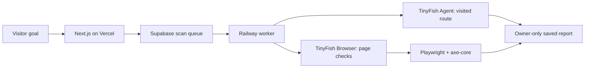

<p align="center">
  
</p>

<h1 align="center">AccessPath</h1>

<p align="center"><strong>Accessibility evidence for the route a visitor actually takes.</strong></p>

AccessPath starts with a visitor goal, discovers the route through a live website, and checks the pages along that route. Its report connects each automated finding to the page, affected element, and screenshot. Human review remains necessary; AccessPath does not certify WCAG conformance.

<p align="center">
  <a href="https://access-path-mu.vercel.app">Live app</a> ·
  <a href="https://access-path-mu.vercel.app/demo-site">Try the controlled site</a> ·
  <a href="https://access-path-mu.vercel.app/reports/demo">Open the verified audit</a>
</p>

> **Working prototype:** A live, approved-site scan has followed Home → Support → Contact, checked all three pages, identified the missing email-field label, and saved the report to an owner-only workspace. Public scanning of arbitrary sites is not enabled.

## The controlled journey

The screenshots below are from the public Northstar test site used by the working scan. The visitor starts at Home, follows Support, and reaches the Contact form. The live report recorded **3 pages checked**, **1 rule with a violation**, **1 affected element**, and **3 page-level checks needing human review**. The finding is axe-core's `label` rule on the contact page's email field, `#demo-email`.

<p align="center">
  
  
</p>

The controlled demo also has a [corrected contact page](https://access-path-mu.vercel.app/demo-site/fixed/contact) for comparison. Both forms are demonstrations and do not send data.

The [public verified demo audit](https://access-path-mu.vercel.app/reports/demo) shows the rule, affected element, and screenshots. Signed-in users can open their own saved live reports from the [dashboard](https://access-path-mu.vercel.app/dashboard).

## Why this matters

A single URL check can miss the context of a task such as finding help or reaching a contact form. AccessPath asks what the visitor is trying to do, follows the route, and makes the resulting accessibility evidence easier to reproduce and act on. The intended users are developers, QA teams, agencies, and teams responsible for public-facing services.

- **Input:** an approved public site and a visitor goal, such as “find the contact form.”
- **Output:** the visited route, page screenshots, automated findings, affected elements, and checks for a person to complete.

## What works today

- A deployed Northstar Services demo with Home, Support, and Contact pages. Its contact page intentionally contains an unlabeled email field; a corrected page is available for comparison.
- TinyFish Web Agent route discovery for the controlled site.
- A verified audit performed in a TinyFish Browser session with Playwright and axe-core. The [saved demo report](https://access-path-mu.vercel.app/reports/demo) shows the `label` rule finding and screenshots of the original and corrected pages.
- Supabase sign-in and owner-only saved reports, including import of a previously exported audit JSON file.
- An invite-only live scan queue with one active scan per account, shared attempt limits, a paused switch, and a Railway worker. The team has opened completed saved reports for both approved targets. The verified demo report remains available independently.
- The private workspace explains known scan failure stages in plain language and suggests a safe next step without exposing raw worker exceptions or silently retrying paid work.
- Compare two saved reports on matching page URLs to see which axe rules were no longer detected, remained, or appeared in the later run. This comparison does not start another scan; a person still verifies the result.

The live queue accepts two exact starting URLs: the [Northstar demo](https://access-path-mu.vercel.app/demo-site) and the [public AccessPath GitHub repository](https://github.com/Apoorvishere/AccessPath). Users can write a visitor goal for either target. It does not scan arbitrary websites, log in, submit forms, or change a target site. The worker audits at most three approved visited pages. GitHub's pages and results can change, so the Northstar fixture remains the reproducible demonstration.

### Wikipedia reading journey (integration pending deployment)

The next approved target starts at Wikipedia's [Web accessibility article](https://en.wikipedia.org/wiki/Web_accessibility). The example goal is to find the linked [Web Content Accessibility Guidelines article](https://en.wikipedia.org/wiki/Web_Content_Accessibility_Guidelines). Only those two public article URLs are permitted for this target. TinyFish records the visited route; the worker then runs axe-core on the visited pages. This is a bounded reading-journey audit, not an audit of Wikipedia as a whole. Follow the [Wikipedia release steps](docs/WIKIPEDIA-TARGET.md) before enabling it. No Wikipedia result is claimed here yet.

## Demo in minutes

Watch the [AccessPath demo video](docs/assets/accesspath-demo.mp4).

1. Open the [controlled demo](https://access-path-mu.vercel.app/demo-site) and follow **Home → Support → Contact**.
2. Open the [verified audit report](https://access-path-mu.vercel.app/reports/demo). Inspect the `label` finding on the contact form and its screenshot.
3. Open the [corrected contact page](https://access-path-mu.vercel.app/demo-site/fixed/contact) to see the associated label.
4. If live scans are enabled for your account, sign in to the [dashboard](https://access-path-mu.vercel.app/dashboard) to view owner-only saved evidence. Invited users may choose the Northstar demo or the public AccessPath GitHub repository and enter a visitor goal. A new live run uses TinyFish credits.

## How it works

1. The user enters a visitor goal for the approved site.
2. TinyFish Web Agent discovers the pages visited while pursuing the goal.
3. TinyFish Browser provides an isolated browser. Playwright opens up to three approved pages, runs axe-core, and captures screenshots.
4. The worker saves the journey and report in Supabase. Row Level Security limits report access to the account owner.

Next.js serves the UI and short API requests on Vercel. A separate Node worker on Railway handles browser work outside the web request. The queue is stored in Supabase PostgreSQL and claimed by a restricted worker function.



The worker confines each scan to its selected approved target and checks at most three visited pages. It does not authenticate to the target site, submit its forms, or make purchases. A paused queue switch, one-active-scan rule, and shared attempt limits control paid runs.

## Local setup

Requires Node.js 24 and pnpm 12.

```powershell
pnpm install
pnpm --filter ./apps/web build
pnpm dev
```

Open `http://localhost:3000`. The public landing page and local demo do not require keys. For sign-in, put the names from the root `.env.example` in `apps/web/.env.local` using your own Supabase project URL and publishable key. The local environment file is ignored by Git.

For a **live scan during a local demonstration**, use `pnpm demo:local` instead of `pnpm dev`. It starts the website and queue worker together and stops both with Ctrl+C. This requires `apps/web/.env.local` and `apps/worker/.env.local`, installed dependencies, `ACCESSPATH_WORKER_ENABLED=true` in the worker file, an enabled database queue, and a configured approved target. Stop the Railway worker while using the local worker so only one worker claims scans. The worker's secret file is loaded into the worker process only. You can check the required local files without starting either process using `node scripts/dev-with-worker.mjs --check`.

The private journey preview and audit routes need additional server-only values listed in the [setup guide](docs/SETUP-AND-DEPLOYMENT.md#4-environment-variables). Keep `TINYFISH_API_KEY` and preview codes out of `NEXT_PUBLIC_*` variables. Never commit credentials or private audit exports.

To create your own database, run the migrations in order from `supabase/migrations/` in a fresh Supabase project. The second migration creates the live queue in the **paused** state. The third migration excludes never-started cancelled jobs from paid-scan limits. The fourth allows a second paid diagnostic attempt in one UTC day; it does not enable the queue. Configure the worker separately with `SUPABASE_URL`, a Supabase `sb_secret_` key, `TINYFISH_API_KEY`, and `ACCESSPATH_WORKER_ENABLED=true`. Do not place the secret key in the web app.

## Checks

```powershell
pnpm --filter ./apps/web build
pnpm --filter @accesspath/worker check
pnpm --filter @accesspath/worker test
```

Start with the [documentation index](docs/README.md) for the architecture, pipeline, data model, security, deployment, demo, and evidence notes. The [controlled fixture](docs/demo-fixture.md) and [verified audit method](docs/demo-audit-validation.md) distinguish recorded evidence from proposed capabilities.

## Scope and limitations

- The live queue is an invite-only preview for two exact approved starts: the Northstar demo and the public AccessPath GitHub repository. Arbitrary-site scans are future work.
- Automated rule counts are not a count of every accessibility barrier or a WCAG conformance score.
- A person still needs to verify findings in context and test keyboard use, screen readers, focus order, and task completion.
- The landing-page journey preview is illustrative; the saved scan report is the record of a real run.

## Next build stage

The hackathon work will extend the tightly approved demo to safe public HTTPS sites, improve scan recovery and cost controls, store evidence privately, and compare a route before and after a fix. These are planned improvements, not current verified features.

## AZINHACK 2026

AccessPath is an open innovation entry for [AZINHACK 2026](https://unstop.com/o/1763832). TinyFish is central to route discovery and provides the browser used for the accessibility checks. The submitted presentation and this repository describe the implemented prototype and the remaining build work.
