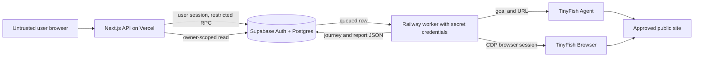

# Security

**Status:** implementation-aligned security design and control inventory for review
**Reviewed against repository:** 18 October 2026
**Project:** AccessPath, AZINHACK 2026

> This document records controls visible in the repository and identifies operational checks the team reported or still needs to perform. It is not a penetration-test report, a guarantee against abuse, or a WCAG conformance statement. Production settings can differ from checked-in migration defaults.

## 1. Scope and assets

AccessPath lets approved users start a paid browser-assisted audit of a narrow set of public targets. Security therefore covers more than account sign-in: the service must protect private reports, provider credentials, the shared scan budget, and third-party sites from unintended requests.

| Asset | Main risk | Current protection or gap |
| --- | --- | --- |
| Supabase accounts and saved scans | Cross-user report disclosure | Supabase Auth, owner-only scan RLS, authenticated report API; team reported a two-account privacy check. |
| TinyFish key and Supabase secret key | Unauthorized provider spend or database access | Worker/server-side environment variables; a secret key must never reach browser code. Repository/bundle audit remains an operational check. |
| Scan budget | Repeated paid runs | Invite list, paused switch, shared attempt caps, one active row per account, idempotency. No money-denominated hard cap in code. |
| Screenshots and route observations | Exposure of page content | Stored in owner-scoped report JSON when retained; no Storage bucket, retention schedule, or automated deletion job. |
| Approved third-party sites | Unwanted automation | Exact target and route allowlists, three-page cap and no-form/no-login instructions. Agent navigation itself is not fully constrained by those instructions. |

The product does not test target-site security and does not authorize scanning sites outside its approved list. The current preview supports the team's controlled Northstar site and its own public GitHub repository.

## 2. Reporting a security issue

Do not post exploit details, credentials, or another person's report in a public GitHub issue. The repository does not yet show a verified monitored security contact or confirmed GitHub private vulnerability reporting setting. **Before inviting public security reports, maintainers should enable GitHub private vulnerability reporting or publish a monitored address.** Until that is configured, ask the repository owner for a private channel without including sensitive details in the initial public message.

For a useful private report, include the affected component, reproducible steps, impact, and only data you own or were authorized to access. Avoid load testing or modifying other users' data on the production service. There is no published bug bounty or guaranteed response time.

## 3. Trust boundaries

The paid live worker does not expose a public HTTP endpoint; it polls a database function. The web tier's authenticated scan API does not perform the live browser audit. A separate **private journey preview** does call TinyFish from server-side Next.js code using a preview access code; the web deployment can therefore hold a TinyFish key for that feature. Its `/api/audits` browser-audit preview is restricted to development mode, while the persisted live queue is handled by Railway. Never state that the web server can never hold a TinyFish key; the actual boundary is that keys must stay server-side and out of client bundles.

The worker's Supabase secret/service credential bypasses normal user RLS and can update scan rows. Its compromise has broader impact than an ordinary account compromise. Supabase's documentation likewise distinguishes publishable and secret keys; use the secret only in controlled server processes.

## 4. URL and navigation policy

For live scans, the web accepts only two exact starting URLs. The database `enqueue_live_scan` function independently checks the same two values. The worker's `approvedPageUrl` policy then requires HTTPS, the exact approved origin, no embedded credentials, no query string, and an allowed route path. Northstar routes are limited to the demo pages; GitHub routes are limited to the team's public repository root and selected `main` branch tree/blob descendants.

Every Agent-returned step is parsed and revalidated before the audit browser starts. One invalid returned URL rejects the journey; it is not silently included. During auditing, a page's final URL must equal the exact approved target URL. A redirect elsewhere fails the live scan before axe-core runs on that page.

**Scope of this control:** This is a strict allowlist for two known public sites, not a general arbitrary-URL SSRF filter. The current worker does not resolve hostnames and check all returned IP addresses, pin DNS to a checked address, or inspect every redirect hop before network navigation. These controls would matter if the product later accepted arbitrary customer-supplied domains. OWASP notes that domain allowlisting alone does not solve DNS rebinding; a broader target policy requires separate design and tests.

**Agent boundary:** The prompt tells TinyFish to stay in scope and avoid login, form submission and purchases, but prompt text cannot guarantee agent behavior on a hostile site. Route validation prevents off-policy URLs from entering the AccessPath audit stage; it does not prove the Agent never visited an off-policy URL during exploration. Test this with a controlled hostile page before expanding target coverage.

## 5. Authentication, authorization and isolation

- Supabase Auth handles account sign-in. The saved-scan list, detail, live-enqueue and import routes require a signed-in session.
- `public.scans` has RLS enabled. The authenticated role has owner-only SELECT; normal clients do not have direct table INSERT/UPDATE. Security-definer functions perform permitted writes after checking `auth.uid()` and their input rules.
- `live_scan_limits` and `live_scan_access` have RLS enabled and normal anonymous/authenticated table privileges revoked. The invite list and queue switch are not normal client-editable data.
- The scan-detail API validates UUID syntax, queries through the signed-in Supabase client, and returns 404 for a well-formed ID without an owner-visible row. The list endpoint relies on RLS and returns at most 30 owner-visible rows.
- The worker uses a server-side Supabase secret/service credential. The worker must never expose its client, key, or CDP session URL to users.
- The team reported two-account privacy tests, but a committed automated `supabase/tests/rls.sql` suite is not in the inspected repository. Re-run cross-account checks after changing policies or report APIs.

The private journey-preview access code is separate from Supabase Auth. It is checked server-side using a constant-time hash comparison. Possession of this code authorizes use of the preview API; it is not a user password or a substitute for owner-scoped saved-report access. Treat a leaked preview code as a spend risk and rotate it.

## 6. Request integrity and abuse bounds

The live and import POST routes reject requests whose `Origin` differs from the request origin, require JSON content type, require a UUID `Idempotency-Key`, and bound request bodies (4 KB live, 800 KB import). They validate input before calling Supabase RPC functions. These checks reduce accidental or cross-site submissions; they are not a general application-wide rate limiter.

The live enqueue database function uses an advisory transaction lock to serialize admission, checks invitation, the database pause switch, one active scan per account, and shared UTC-day/lifetime attempt caps. A unique partial index also disallows two queued/running rows for one owner. The latest checked-in migrations set shared caps to at least six daily and twelve lifetime attempts, but an operator can change production values. There is no current per-account daily live limit, per-domain active-scan cap, four-session global cap, or direct currency spend cap.

The queue can be paused through `live_scan_limits.enabled`; this stops new submissions and claims. It does **not** stop a worker already processing a claimed scan. One worker process handles one claimed scan at a time. Agent polling, browser creation, page loads, number of pages, screenshots and JSON sizes have code-level bounds. These limit exposure but cannot guarantee a maximum bill across provider behavior and concurrent replicas.

Vercel documents platform-level DDoS mitigation. The repository does not prove any project-specific WAF rule, rate-limit configuration, alert, or firewall exception is enabled. Treat those as deployment settings to inspect, not controls already verified for AccessPath.

## 7. Evidence and privacy

The live worker captures viewport JPEG screenshots. A screenshot above 350 KB is omitted; additional screenshots may be removed to fit the report JSON size target. Retained screenshots are embedded as base64 data URLs inside the owner-scoped `scans.report` JSON column, not uploaded to a private Supabase Storage bucket. The report detail API returns this JSON to the signed-in owner. No short-lived signed links are issued.

The public before/after demo report intentionally displays screenshots of the team's controlled fixture. That is separate from private user reports. Do not publish private report JSON, scan IDs linked to identifiable users, raw CDP URLs, or screenshots from third-party pages without reviewing their content and permission.

The database deletes a user's scan rows when their Supabase Auth user row is deleted, via a foreign key with `ON DELETE CASCADE`. There is no separate stated report retention period or scheduled deletion process in the inspected code. A privacy policy is noted as in preparation in the web UI. Before inviting broader public use, document retention, user deletion requests, provider data handling, and screenshot publication rules.

## 8. Untrusted text, injection and rendering

User goals, target pages, Agent summaries, titles, actions, observations, selectors and help text are untrusted data. The worker checks the structured journey shape, bounds text lengths, and validates returned URLs. The report is rendered in React text/code contexts, which escape text by default; outgoing rule-guidance links are allowed only if they parse as HTTPS without embedded credentials. This is narrower than claiming every possible value is sanitized in every context.

The Agent prompt is built from a fixed template containing the user's task and safety instructions, but the user task and website content still influence the AI Agent. There is no evidence in the inspected repository of dedicated prompt-injection or XSS fixtures. Add controlled tests before describing prompt-injection resilience as verified.

For the approved GitHub audit, the worker uses CDP `Page.setBypassCSP` to inject axe-core. This bypass is limited by the approved-route checks in the audit code but intentionally disables a page protection within that remote browser session. Keep the CDP URL private, and do not describe the audited page's CSP as a protection against the worker itself.

## 9. Secrets, logs and operational configuration

`TINYFISH_API_KEY` is used by the worker and by the separate server-side journey preview where configured. `SUPABASE_SECRET_KEY` is worker-only. `NEXT_PUBLIC_SUPABASE_PUBLISHABLE_KEY` is intentionally public; it is **not** interchangeable with a secret/service key. `.env*` files other than `.env.example` and `docs/evidence/` are Git-ignored in the inspected repository, but ignore rules do not undo a past leak or prevent a manual paste into a screenshot.

The worker has best-effort log redaction for URLs, bearer tokens, Supabase secret-key patterns and JWT-like strings. Audit failures also limit logged line length and redact long token-like values. This is useful but incomplete; novel secret formats, page content in upstream exceptions, and platform logs still need review. Do not claim that logs can never contain sensitive data.

Before a release, search Git history and working files for secret patterns, review client bundles, check Vercel/Railway variable scopes, and inspect recent logs with keys hidden. If a key was exposed, rotate it at the provider, update the deployment, and review usage; deleting a file or commit alone does not invalidate the credential.

## 10. Failure recovery and incident response

There are no lease heartbeats or automatic retries. A worker crash after a claim can leave a scan `running`, and the provider may already have charged for it. Browser cleanup is attempted in `finally`; failure logs a warning but is not automatically retried. Treat a stalled scan as an operator investigation, not as permission to queue another run immediately.

| Event | First actions |
| --- | --- |
| TinyFish or Supabase secret suspected exposed | Pause live queue; rotate the affected credential; redeploy worker/server as needed; inspect provider usage and logs. |
| Preview code suspected exposed | Rotate the code and inspect private preview usage; consider disabling preview until reviewed. |
| Cross-user report exposure suspected | Stop affected access path, verify RLS and API behavior, identify affected users, preserve evidence, and plan notification with the team. |
| Unexplained spend or queue flood | Pause `live_scan_limits.enabled`, inspect admitted rows and provider activity, then adjust controls after understanding the cause. |
| Browser session may be leaked | Inspect TinyFish dashboard, end session through provider controls if available, and repair cleanup behavior. |
| Worker stuck on `running` | Match scan timestamps to Railway and TinyFish activity before any manual database change or paid retry. |

Maintain a brief private incident record: detection time, affected components, actions, users/data potentially affected, and the follow-up fix. Pausing the queue prevents new claims but does not retroactively cancel work already running.

## 11. Control status on 18 October 2026

| Control | Current status | Evidence or next check |
| --- | --- | --- |
| Exact approved start and route allowlists | Implemented | Web, database function and worker policy; worker target tests cover representative rejects. |
| Return-route validation before audit | Implemented | Worker parser and target tests; Agent activity outside the returned route is not proven absent. |
| Final audited URL equality check | Implemented | Browser audit code; add redirect regression fixture. |
| General DNS/IP SSRF controls | Not implemented | Required before accepting arbitrary target domains. |
| Supabase Auth and owner-only scan RLS | Implemented, team-tested | Migration and team-reported two-account checks; automate regression test. |
| Invite list, pause switch, one-active-user and shared caps | Implemented | Migrations and API; inspect live production settings. |
| Idempotency and single-claim queue | Implemented | Unique index and `SKIP LOCKED`; no lease recovery or automatic retry. |
| Screenshot size and report JSON bounds | Implemented | Worker and database constraints; screenshots remain embedded JSON. |
| Private Storage and signed screenshot URLs | Not implemented | Consider only if evidence volume requires it. |
| Browser session cleanup attempt | Implemented | `finally` deletion; no automated retry/alert verified. |
| Secret scope and log redaction | Partly implemented | Server-only variable use and redaction code; audit deployed bundles/logs. |
| Prompt-injection/XSS fixtures | Not demonstrated | Add controlled tests before making resistance claims. |
| Project-specific WAF/alerts | Not verified | Inspect Vercel, Railway, Supabase and TinyFish settings. |
| Security contact and evidence retention policy | Not established | Configure private reporting and document retention before broader use. |

Status labels describe source evidence, not a professional security certification. A future audit should test deployed settings, permission boundaries, provider behavior and incident response as well as code.

## 12. Known limitations and next work

- The approved-target policy is narrow by design; general-site scanning requires a stronger URL/redirect/DNS model and permission workflow.
- A hostile page may influence Agent behavior even if AccessPath later rejects its returned URL.
- Embedded screenshots can make private responses large and require deliberate retention and disclosure rules.
- There is no user-facing cancel route, provider cancellation on Agent timeout, or automatic recovery of a stuck running row.
- Vercel platform defenses reduce some network abuse risks but are not an immunity claim.
- Automated accessibility checks do not establish WCAG conformance; human testing remains required.

Prioritize a private vulnerability-reporting channel, repeated two-account tests, a controlled prompt-injection fixture, operational alerts, and a written evidence-retention policy before inviting more users or widening target coverage.

## 13. Verification plan before broader access

The following checks produce evidence for changing a row in the control table from “implemented” to “verified in deployment.” They should run against a test environment or carefully controlled production accounts, without exposing another person's data.

### Account isolation

Create two ordinary Supabase accounts. With account A, save an imported report and complete an invited live scan. With account B, confirm that A's rows do not appear in `GET /api/scans`, that a direct request for A's well-formed scan ID returns 404, and that B cannot write to A's row through the normal Supabase client. Record the test date and deployed commit. Repeat after any RLS or API change.

### Admission and spend

With the queue paused, confirm that enqueue returns a paused response and the worker claims no new row. Re-enable it only for an approved budgeted test. Confirm the invite check, exact target check, duplicate idempotency-key behavior, and one-active-row rule. Compare the admitted rows with TinyFish dashboard usage. Test budget exhaustion using controlled values; do not consume credits merely to prove a rejection path.

### Target and browser boundary

Use fixtures for wrong origin, query-bearing URL, login path, redirected final URL, and off-policy Agent output. Confirm the worker rejects them before the audit stage or before recording a page as checked. Include a controlled page that tries to instruct the Agent to leave the approved area; review both the Agent's actual navigation and the returned route. For CSP-restricted pages, confirm axe injection works only inside the approved audit browser route and that the session is deleted on success and failure.

### Secrets, logs and evidence

Inspect the built client assets for private variable names or key-like values, and review recent platform logs with authorized maintainers. Verify that example screenshots contain only approved public fixture data. Check whether a failed browser session remained active in TinyFish. Confirm a monitored private reporting path and a written retention/deletion decision before opening access to more users.

Document the exact result and unresolved risks. Passing these checks would support specific operational claims; it would not make the service immune to new vulnerabilities.

## 14. References

- [Architecture](./ARCHITECTURE.md)
- [Data model and API](./DATA-AND-API.md)
- [TinyFish and audit pipeline](./TINYFISH-PIPELINE.md)
- [Supabase Row Level Security](https://supabase.com/docs/guides/database/postgres/row-level-security)
- [Supabase API keys](https://supabase.com/docs/guides/getting-started/api-keys)
- [Supabase database functions](https://supabase.com/docs/guides/database/functions)
- [OWASP SSRF Prevention Cheat Sheet](https://cheatsheetseries.owasp.org/cheatsheets/Server_Side_Request_Forgery_Prevention_Cheat_Sheet.html)
- [Vercel DDoS mitigation](https://vercel.com/docs/vercel-firewall/ddos-mitigation)
- [GitHub private vulnerability reporting](https://docs.github.com/en/code-security/how-tos/report-and-fix-vulnerabilities/configure-vulnerability-reporting/configure-for-a-repository)

The source draft linked to `SETUP-AND-DEPLOYMENT.md`, which was not present in the inspected repository. Add the link after that document exists and has been reviewed.
