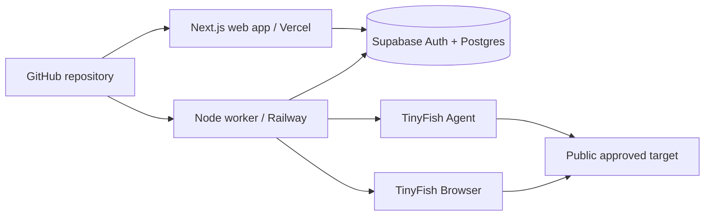

# Setup, testing and deployment

**Status:** implementation-aligned operational guide
**Reviewed against repository:** 18 October 2026
**Project:** AccessPath, AZINHACK 2026

> This guide uses checked-in commands and files. It does not contain credentials or claim access to the current Vercel, Railway, Supabase or TinyFish settings. A live scan consumes provider credits; enable one only when the team has approved the target and attempt budget.

## 1. Deployment shape



The controlled Northstar demo pages live inside the Next.js web app and are deployed at `/demo-site`, `/demo-site/support`, `/demo-site/contact`, and `/demo-site/fixed/contact`. They are not a separate `demo-site/` package. The worker is a long-running process with no public HTTP route. The web and worker coordinate through Supabase rows and restricted database functions. Screenshots are embedded in owner-scoped report JSON when retained; no Supabase Storage bucket is used for current scan evidence.

The live preview currently permits two exact start URLs: the Northstar demo and the team's public GitHub repository. The worker will audit at most three approved pages for a goal. An arbitrary public URL cannot be submitted.

## 2. Prerequisites

| Item | Current requirement |
| --- | --- |
| Git | Clone and update the repository. |
| Node.js | Node 24 is the recommended local version in the README; the worker package declares `>=20`. |
| pnpm | Root package declares pnpm 12.14.0 and the repository has one lockfile. |
| Supabase project | Required for accounts, saved reports and live queue; a new project is safest for first migration application. |
| TinyFish API key | Required only for the private preview and/or live worker, not the public landing page. Provider usage can cost credits. |
| Vercel and Railway projects | Required for the hosted web app and worker. |

The checked-in repository does **not** require a Supabase CLI or Dockerfile to run its documented path. The team has applied SQL migrations through the Supabase SQL Editor. If choosing the CLI later, document and verify that workflow separately. The worker package has no Dockerfile in the inspected repository.

## 3. Clone, install and check the code

From PowerShell:

```powershell
git clone https://github.com/Apoorvishere/AccessPath.git
Set-Location AccessPath
pnpm install
pnpm --filter ./apps/web build
pnpm --filter @accesspath/worker check
pnpm --filter @accesspath/worker test
```

The web command compiles and typechecks the Next.js app. The worker `check` command runs `tsc --noEmit`. The worker `test` command runs focused `node:test` cases through `tsx`; the checked-in tests validate representative Northstar and GitHub journey URL acceptance/rejection and blocked-journey behavior. These tests do not call the paid TinyFish APIs. There is no root `pnpm test` or `pnpm typecheck` script and no checked-in `.github/workflows/ci.yml` in the inspected repository.

The user's earlier production web build completed successfully, and the team reported live Northstar and GitHub reports. These are operational observations, not a promise that a clean clone will pass forever; rerun the commands at the release commit.

## 4. Environment variables

Never commit `.env.local`, a TinyFish key, a Supabase secret key, a browser CDP URL, or a real report export. The root `.gitignore` ignores `.env` and `.env.*` except `.env.example`, and ignores `docs/evidence/`. Verify Git status before committing.

### Web app, local and Vercel

Create `apps/web/.env.local` for local use. The root `.env.example` lists the two public Supabase values. The private preview values are documented below; there is no separate `apps/web/.env.example`. Actual names used by the current code are:

| Variable | Scope and purpose |
| --- | --- |
| `NEXT_PUBLIC_SUPABASE_URL` | Browser-safe Supabase project URL for Auth and client requests. |
| `NEXT_PUBLIC_SUPABASE_PUBLISHABLE_KEY` | Browser-safe publishable key; database RLS still governs user data. |
| `NEXT_PUBLIC_ACCESSPATH_LIVE_SCANS_ENABLED` | Set to `true` to show the live UI and let the live POST route accept requests. This is an operational flag, not the database budget authority. |
| `TINYFISH_API_KEY` | Server-side key for the separate private journey preview when that feature is configured. Never prefix with `NEXT_PUBLIC_`. |
| `ACCESSPATH_DEMO_CODE` | Server-side private journey-preview access code; code requires at least 16 characters. |
| `ACCESSPATH_ALLOWED_HOSTS` | Exact comma-separated hostnames for the private journey preview. This is separate from the live worker's fixed target policy. |
| `ACCESSPATH_AUDIT_ENABLED` | Set to `true` only for the local, development-only browser audit preview when intentionally testing it. |

The live queued worker does not use the web server's `TINYFISH_API_KEY`; however, the private journey-preview routes can use a server-side TinyFish key on Vercel. Configure only features you intend to operate. A missing private-preview key does not prevent the public landing page from loading.

### Railway worker

| Variable | Scope and purpose |
| --- | --- |
| `SUPABASE_URL` | Supabase project URL for the worker client. |
| `SUPABASE_SECRET_KEY` | Supabase secret/service credential required for restricted queue claiming and scan updates. A publishable key will fail. |
| `TINYFISH_API_KEY` | Paid Agent and Browser API calls. |
| `ACCESSPATH_WORKER_ENABLED` | Must be exactly `true` for the worker to start. |

Keep worker secrets in Railway service variables, not in GitHub or Vercel public variables. A secret key bypasses normal user RLS, so rotate it promptly if exposed. Record which teammate owns each external account and where rotation is performed, without putting key values in documentation.

### One-command local live demo

For a local demonstration with live scans, create the ignored `apps/web/.env.local` and `apps/worker/.env.local` files using the variables above. Set `ACCESSPATH_WORKER_ENABLED=true` in the worker file, confirm the Supabase queue is enabled, and stop the Railway worker before starting a local worker. From the repository root, run `pnpm demo:local`. This launches Next.js on port 3000 and the queue worker in the same terminal; Ctrl+C stops both. If either process exits, the launcher stops the other. The worker environment file is loaded only by the worker process, not by the website. `node scripts/dev-with-worker.mjs --check` validates that the local files and installed tools are present without starting a scan.

## 5. Supabase database setup

The repository contains eight dated SQL files in `supabase/migrations/`, from `202610180001_saved_scans.sql` through `202610180008_browser_csp_retry_budget.sql`. Apply them **in filename order once to a fresh project** through the Supabase SQL Editor, reviewing each before running it. Some migrations create tables and functions without `IF NOT EXISTS`; rerunning the full sequence on an already migrated database can fail with “relation already exists.” Do not treat that error as proof that the entire migration sequence succeeded.

The first migration creates the owner-scoped `scans` table, RLS policy and import function. The second adds journey/failure fields, the live queue, an invitation table and a paused switch. Subsequent migrations adjust cancellation accounting, approved GitHub target and preview budgets; `202610200001_wikipedia_target.sql` adds the Wikipedia start while preserving the current queue switch and budgets. Applying a migration changes Supabase only; it does not deploy the Railway worker or Vercel app. Several migrations explicitly leave `live_scan_limits.enabled = false`; enabling the queue is a separate operator decision after deployment and cost checks.

After applying the migrations, verify without sharing secrets:

1. The `scans` table exists with RLS enabled and owner-only SELECT policy.
2. `live_scan_limits` has one row and the intended `enabled`, UTC-day cap and lifetime cap values.
3. `live_scan_access` contains only invited account IDs; normal authenticated clients cannot edit it.
4. `enqueue_live_scan` accepts only approved start URLs and `claim_live_scan` is executable by the worker's privileged role, not normal clients.
5. Two separate test accounts cannot list or read each other's scan rows.

The latest checked-in migrations set shared cap **floors** of six UTC-day and twelve lifetime attempts, not fixed production values or a currency spend cap. Read the current row in Supabase before reporting a limit. There is no committed `supabase/tests/rls.sql`; the team reported running privacy checks manually.

## 6. Local web development

The public landing page and controlled demo can run without Supabase or TinyFish credentials:

```powershell
pnpm dev
```

Open `http://localhost:3000/` or `http://localhost:3000/demo-site`. With the two Supabase public values in `apps/web/.env.local`, the app can show sign-in and the saved-scan dashboard. The local site itself is **not** an approved live-scan starting target: TinyFish's cloud services need a public HTTPS target, and the current live allowlist points to the production Northstar URL and public GitHub repository.

To run the private journey preview, add its server-only values and approved hosts. The separate `/api/audits` browser preview is guarded by `NODE_ENV === development` and `ACCESSPATH_AUDIT_ENABLED=true`; it is not the production queue path. A local web app can still connect to the production Supabase project if given its values, so use a separate development project when you do not intend to affect live data or budgets.

Do not start the Railway-style worker locally merely to view the site. A running worker plus an enabled queue can claim paid work. If you deliberately test the worker locally, use a development Supabase project, explicitly approved TinyFish budget, the four worker variables above, and the package script `pnpm --filter @accesspath/worker start`.

## 7. Controlled demo and evidence

The Northstar fixture is part of the web app. The original Contact page intentionally lacks a programmatic label for its email field. The corrected Contact page uses an associated visible label. The public report at `/reports/demo` compares that one rule-level fix from a dated real browser audit. A later live queued run followed Home -> Support -> Contact, checked three pages, and saved an owner-only report with one rule violation affecting one element and three page-level checks needing review.

Do not state that the controlled demo has two currently verified defects. An earlier Home-page capture reflected an unstable deployment and was excluded from the published comparison. The two reports come from separate runs; keep their counts separate. A corrected `label` rule result is not whole-site WCAG conformance.

## 8. Tests and release checks

Run these repository-supported commands before a release:

```powershell
pnpm --filter ./apps/web build
pnpm --filter @accesspath/worker check
pnpm --filter @accesspath/worker test
```

Also perform a manual two-account read test after RLS or API changes. For a budget-approved live test, record the deployed commit, target, task, status transitions, completed report link (private), provider run/session outcome, and cleanup result. Keep API keys and private IDs out of public screenshots.

The repository includes `.github/workflows/checks.yml`, which runs web lint/build and worker TypeScript checks on pushes and pull requests. It does not run the worker test script, verify database concurrency, production deployments, provider cleanup, or accessibility of the whole visitor task. Confirm the workflow result in GitHub before treating checks as passed for a release commit.

## 9. Vercel web deployment

The team has a working Vercel deployment at `https://access-path-mu.vercel.app`. The checked-in web package provides `dev`, `build`, `start` and `lint` scripts. In a monorepo deployment, configure Vercel so install/build run with the root lockfile and build the web package; confirm the actual Root Directory and Build Command in Vercel rather than assuming a setting from this guide.

Set the two public Supabase values for the intended environment. Set `NEXT_PUBLIC_ACCESSPATH_LIVE_SCANS_ENABLED=true` only when the live preview is intended to be visible; redeploy after changing a `NEXT_PUBLIC_*` value because it is included in the client build. Configure private journey-preview values only if operating that feature. Never put the worker's Supabase secret key in Vercel client variables.

Verify the deployed landing page, `/demo-site`, `/reports/demo`, sign-in, dashboard, and owner-only report behavior. The app's public comparison can remain available when live scans are paused. The web feature flag does not override the database pause switch or shared budgets.

## 10. Railway worker deployment

The worker package's start script is `tsx src/index.ts`; its check script is `tsc --noEmit`. The team previously configured Railway from the GitHub repository and observed an active worker with “AccessPath controlled-scan worker started.” There is **no Dockerfile or heartbeat endpoint** in the inspected repository. Confirm Railway's current repository, branch, root/build/start settings in its UI; do not infer them from old deployment screenshots.

Configure the four worker variables in Railway. A safe build check is `pnpm --filter @accesspath/worker check`; a start command can call `pnpm --filter @accesspath/worker start` from the repository root. The exact Railway working directory matters, so verify command context in the service settings and logs. No public domain is required for this polling worker.

After deployment, check that queue polling is healthy and that no `Queue claim error` repeats. A prior permission error was caused by using a publishable key where the worker required a secret key. The team corrected the key and reported the error stopped. If the process is active but scans do not move, inspect the database pause switch, invite list, worker logs and scan row state before changing budgets.

## 11. Enable and operate a paid live scan

1. Confirm the approved target and goal, TinyFish credit balance, Railway worker health and the current Supabase `live_scan_limits` row.
2. Confirm the intended user is in `live_scan_access` and the Vercel live flag is deployed.
3. Set `live_scan_limits.enabled = true` only for the planned preview window. This is an operator database action; keep caps at the agreed team budget.
4. Start one scan from the dashboard. Its row should move `queued` -> `running` -> `completed` or `failed`. The dashboard refreshes active statuses.
5. Open the private report, verify the route and page evidence, and check TinyFish activity and browser-session cleanup.
6. Pause the queue again when the planned test window ends or investigation is needed. Pausing stops new submissions/claims but does not interrupt a scan already running.

The account's dashboard does not provide a cancellation button or retry action for running scans. The worker intentionally does not auto-retry a paid scan after a crash. Before manually changing a stuck `running` row or starting another scan, match Railway logs, timestamps and TinyFish usage so the team does not pay twice unknowingly.

## 12. Monitoring and response

The worker logs startup, queue-claim problems, completed scans, stage failures, and browser-cleanup warnings. Supabase holds scan state and failure codes; the owner-scoped scan list exposes only known failure codes and the dashboard maps them to plain-language guidance, while the scan-detail API does not expose the code. TinyFish dashboard provides provider-side run/session information to the key owner. These are the current operational evidence sources.

The repository does not configure alerting for queue depth, worker heartbeat, 429 volume, spend or orphaned sessions. Inspect platform settings before claiming any alert is live. Recommended next work is a small runbook, a worker liveness check, session cleanup monitoring, cost-per-completed-report tracking, and notifications for repeated failures.

If a secret appears in Git, chat, a screenshot or logs, rotate it at its provider, replace it in the relevant deployment, and review activity. Removing the string from a document or commit alone does not invalidate it.

## 13. Troubleshooting

| Symptom | First checks |
| --- | --- |
| Login form disabled | Confirm `NEXT_PUBLIC_SUPABASE_URL` and `NEXT_PUBLIC_SUPABASE_PUBLISHABLE_KEY` in the deployed web environment; redeploy. |
| `relation "scans" already exists` during SQL setup | Check which migrations were already run and inspect table/functions; do not rerun the whole sequence blindly. |
| Live scan button absent | Confirm the Vercel `NEXT_PUBLIC_ACCESSPATH_LIVE_SCANS_ENABLED` build setting and redeploy. |
| “Live scans are paused” | Inspect `live_scan_limits.enabled`; enable only after worker and budget checks. |
| “Account not enabled” | Check invitation row for that user in `live_scan_access`. |
| 409 on submission | Existing queued or running scan for that account. Inspect its state before retrying. |
| 429 on submission | Shared UTC-day/lifetime live budget or daily imported-report cap; read the relevant current database values. |
| Stuck `queued` | Check worker state, queue pause switch, secret-key permissions and Railway logs. |
| Stuck `running` | Match worker logs and TinyFish activity; the worker has no lease-based recovery. |
| Audit fails during axe injection | Check CSP bypass path, deployed worker version and stage log; GitHub's CSP previously exposed this integration issue. |
| Browser/session failure | Check TinyFish dashboard and cleanup warning; a provider session may need manual review. |
| Report has no screenshot | The image may have exceeded 350 KB or been removed to fit JSON size; findings can still be present. |
| Another account can read a report | Pause access, inspect RLS and API deployment, and treat it as a privacy incident. |

## 14. Release checklist

- [ ] Web build, worker TypeScript check and focused worker tests pass on the release commit.
- [ ] Applied migration order and production `live_scan_limits` values are recorded privately.
- [ ] Two-account isolation is rechecked after data/API changes.
- [ ] Vercel and Railway point to the intended commit and have only the required variable scopes.
- [ ] No credentials, CDP URLs or private reports appear in Git status, documentation, screenshots or logs.
- [ ] The public Northstar comparison matches the current controlled pages.
- [ ] One approved live run completes when the team chooses to spend credits; record failure and cleanup if it does not.
- [ ] Queue is paused or open according to the current test window; caps match the team's budget.
- [ ] Documentation claims match shipped behavior; planned alerting, Storage and recovery are not described as live.

## 15. Implementation status

| Capability | Status on 18 October 2026 | Evidence or limit |
| --- | --- | --- |
| Web app and controlled demo deployed | Team-verified | Vercel live URL and public comparison report. |
| Supabase schema and owner-only reports | Implemented, team-tested | Migrations and team-reported two-account privacy checks. |
| Railway worker deployed | Team-verified | Active startup log and completed Northstar/GitHub reports. |
| Northstar three-page live report | Team-verified | Saved route and finding. |
| GitHub approved-target report | Team-verified | Team reported a completed report; no issue total asserted. |
| Web build, worker checks | Supported | Commands in package scripts; rerun at release commit. |
| Automatic source checks | Implemented in source; hosted run pending | `.github/workflows/checks.yml` runs web lint/build and worker TypeScript check. It does not run worker tests. |
| Worker heartbeat and automated alerts | Not implemented | Use logs, scan state and provider dashboard for now. |
| Private Storage screenshots | Not implemented | Evidence is optional data URL in scan JSON. |

## 16. References

- [Architecture](./ARCHITECTURE.md)
- [Data model and API](./DATA-AND-API.md)
- [Security](./SECURITY.md)
- [TinyFish and audit pipeline](./TINYFISH-PIPELINE.md)
- [Repository README](../README.md)
- [Controlled demo validation](./demo-audit-validation.md)

The checked-in files and actual service settings are the source of truth for setup. Update this guide whenever commands, migration order, variables, targets or provider limits change.
