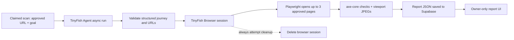

# TinyFish and audit pipeline

**Status:** implementation-aligned technical documentation for review
**Reviewed against repository:** 18 October 2026
**Project:** AccessPath, AZINHACK 2026

> This document describes the live controlled-scan worker as implemented. A separate, local-only audit preview and an older public comparison report are identified where relevant. Provider behavior, charges, and deployed configuration can change; check the current dashboards before quoting operational values.

## 1. Purpose and scope

AccessPath combines two TinyFish capabilities with Playwright and axe-core. The **Agent** explores a public website in response to a visitor goal. The **Browser** gives the worker a remote Chromium session in which it revisits the approved route, runs automated checks, and captures viewport screenshots. The journey and report are then saved to the signed-in user's Supabase scan row.

This separation matters. An agent can find a route from a natural-language task; a controlled browser can run a repeatable rule engine on selected pages. The two sessions do **not** share cookies or interaction state. The audit revisits URLs, so it may not reproduce pages that depended on prior clicks or dynamic state.

The live queue currently accepts only the approved Northstar demo and the team's own public GitHub repository. A goal can vary, but an arbitrary website cannot be entered. Each live audit checks at most **three** approved pages.

## 2. At-a-glance flow



The live worker runs outside Next.js request handlers. Supabase's `claim_live_scan` function supplies one queued scan; the worker processes it and saves either `completed` or `failed`. There is no live partial-result write path or automatic retry after a paid attempt.

| Stage | Current source | Main output |
| --- | --- | --- |
| Claim and save | `apps/worker/src/index.ts` | Running row, then completed report or failed code |
| Agent journey | `apps/worker/src/tinyfish.ts` | `outcome`, summary, ordered steps |
| Target policy | `apps/worker/src/targets.ts` | Approved start and route URLs |
| Browser audit | `apps/worker/src/audit.ts` | Page summaries and optional screenshots |
| Types | `apps/worker/src/audit-types.ts` | Report shape used by the worker |

## 3. Stage 1: TinyFish Agent route discovery

The worker calls `POST https://agent.tinyfish.ai/v1/automation/run-async` with the approved starting URL, a server-composed goal, a structured output schema, and `agent_config.max_duration_seconds = 90`. It then polls `GET /v1/runs/{run_id}` every three seconds for up to 80 attempts. This polling allowance covers startup and result finalization beyond the requested agent duration; it is not a promise that the job finishes within 90 seconds.

The goal template includes the user's task and tells the agent to stay inside the approved public area, visit at most three pages, avoid login, form submission, purchases and data changes, and return factual observations. These are behavioral instructions to the provider. **They are not an enforcement boundary:** the agent could still visit an unintended page during exploration. AccessPath validates the returned route before starting its own audit browser.

The requested result shape is:

```json
{
  "outcome": "completed | not_found | blocked",
  "summary": "Short description of the result",
  "steps": [
    {"title": "Page title", "url": "https://approved.example/path", "action": "What happened", "observation": "What was visible"}
  ]
}
```

This is a **shape example**, not a captured provider response. The worker accepts a maximum of six step objects in the structured result, trims text fields to bounded lengths, and requires a valid approved URL for each step. It uses TypeScript runtime checks, not a shared Zod contract package. A malformed result fails the scan; it is not repaired with invented route entries.

If TinyFish reports `FAILED` or `CANCELLED`, returns an unknown state, does not complete in the polling window, or supplies invalid structured data, the worker fails the scan. It does **not** currently call a provider cancellation endpoint on polling timeout; an operator should check the TinyFish dashboard when provider usage is uncertain.

## 4. Stage 2: Route validation

The live policy is a narrow allowlist, not a general-purpose public-web URL validator. The exact start URL must match either the Northstar demo or the team's public GitHub repository. For every returned step, the worker checks HTTPS, exact approved origin, no embedded credentials, no query string, and a target-specific approved path. It removes the fragment before recording the URL.

Northstar paths are restricted to the demo home, Support, Contact, and corrected Contact routes. GitHub paths are restricted to the public `Apoorvishere/AccessPath` repository root and selected `tree/main` or `blob/main` descendants. Other GitHub pages, other repositories, or another branch are not approved.

All steps are validated. The worker does not silently discard a bad step: one invalid URL makes `parseJourney` reject the result. For a completed journey, it then takes the first three **unique** approved step URLs for audit. A `not_found` or `blocked` outcome produces no audit URLs and a failed scan with a reason code.

The target rules rely on exact HTTPS origin and path checks. This release does **not** implement DNS resolution/IP-range checks on arbitrary user domains or inspection of every redirect hop. During audit, Playwright requires the loaded final URL to equal the exact approved target; a redirect elsewhere fails the scan before it is reported as checked.

## 5. Stage 3: TinyFish Browser session

The worker creates one session through the TinyFish Browser API with the first approved URL and a requested `timeout_seconds` of 180. The response must include a `session_id` and `cdp_url`. Playwright Core connects over CDP to the provider's existing browser context and page. The code deliberately uses the existing page: opening another context/page caused session failures during integration testing.

Before paying for a Browser session, the worker checks that the installed axe-core browser script can be read. After creating the session it sets `Page.setBypassCSP` through CDP so axe-core can be injected on approved pages with restrictive Content Security Policy, including the approved GitHub route.

The worker closes Playwright and attempts to delete the TinyFish session in `finally`. If deletion fails, it logs a warning for manual dashboard review. It does not currently retry deletion or have automated leak alerts. A session can still remain active if the process is killed before cleanup, so provider usage must be checked after abrupt failures.

## 6. Stage 4: Page audit

For each of up to three approved URLs, in route order, the worker:

1. Navigates with `waitUntil: "domcontentloaded"` and a 30-second timeout.
2. Requires an HTTP-success response and an exact approved final URL.
3. Injects the installed `axe-core/axe.min.js` file and runs rules tagged `wcag2a`, `wcag2aa`, `wcag21a`, and `wcag21aa`.
4. Summarizes rule violations, incomplete checks, and passed-rule count.
5. Captures a viewport JPEG (`quality: 65`, not a full-page image).

The summarized result stores up to 30 violation rules. Per rule it keeps the axe ID, impact, help text, help URL, affected-node count, and up to five target selectors. The `needsReviewCount` is the number of axe `incomplete` rule results; it is **not** a count of every unresolved element or a full human-review plan. The `passedRuleCount` is the number of passed rule results, not proof that the page is accessible.

Each screenshot is included as a `data:image/jpeg;base64,...` string only when the JPEG is at most 350 KB. A larger screenshot is set to `null`. The report stores the page URL, title, violation summaries, incomplete/passed counts, optional screenshot and checked-at time.

If any approved page fails to load, has a redirected final URL, blocks injection, errors during axe, or fails screenshot capture, the whole live scan fails. The current worker does **not** persist preceding pages as a partial result. A failed check is not a pass.

## 7. Stage 5: Size control and storage

`apps/worker/src/index.ts` serializes the report before saving. If it exceeds about 850 KB, it drops the largest screenshot previews until it fits; if no screenshot can be removed and it is still too large, saving fails. The database has a 1 MB JSON report constraint and a 30 KB journey JSON constraint.

The current data model stores the journey and report as JSON columns on a single owner-scoped `scans` row. It does **not** create one finding row per element, preserve the entire raw axe response, use an `artifacts` table, upload images to Supabase Storage, or issue signed screenshot links. The count of affected elements is retained, but selectors are capped and individual raw node details are not retained in this live report schema.

For private report access, the web API checks the signed-in session and Supabase RLS limits reads to the row owner. Because screenshots are embedded in JSON, report responses may be large; moving them to private object storage is a possible later design change.

## 8. Time, cost and concurrency bounds

| Bound | Implemented value or behavior |
| --- | --- |
| Agent request | 30-second start-request timeout; provider requested maximum duration of 90 seconds |
| Agent polling | Up to 80 polls, three seconds apart, with a 15-second timeout on each HTTP poll |
| Browser creation | 65-second request timeout; 180-second requested session timeout |
| CDP connection | 30-second connection timeout |
| Page navigation | 30 seconds per approved page |
| Pages | At most three unique approved pages per live audit |
| Screenshot | Viewport JPEG, at most 350 KB retained per page |
| Report | Worker targets about 850 KB; database limit is 1 MB |
| Active scans | One queued/running scan per account; one scan at a time per worker process |
| Shared attempts | UTC-day and lifetime caps in Supabase, adjustable by an operator |

The checked-in database migrations set shared budget **floors** of six UTC-day and twelve lifetime attempts; actual production values may differ. A paused switch controls both enqueue and claim. The code does not enforce one active scan per target domain, four browser sessions globally, or a money-denominated spend cap. There is no published measured average cost or duration per completed report.

## 9. Failure behavior and operator response

| Situation | Current outcome |
| --- | --- |
| Agent reports blocked/not found | Failed scan with `journey_blocked` or `goal_not_found` when no auditable route exists. |
| Agent request, poll, timeout or invalid output | Failed scan with a journey-stage code. |
| Invalid returned URL | Journey parser rejects it and the scan fails. |
| Browser creation, CDP, page audit, screenshot or save error | Failed scan when outcome write succeeds; stage detail goes to redacted worker logs. |
| Browser deletion fails | Warning logged; check TinyFish dashboard for a lingering session. |
| Worker crashes after claim | Row can remain `running`; no automatic paid retry. |
| Outcome update fails | Worker logs that manual database review is required. |

Operator sequence after failure: inspect the saved scan state, the latest Railway stage line, and the matching TinyFish Agent/Browser activity. Do not reset a `running` row or trigger another paid run solely because the UI appears stalled. Verify whether the provider already performed billable work, then decide deliberately whether to retry. The source code redacts common URL and secret patterns from logs, but keys should never be pasted into support messages or documentation.

## 10. Separate local preview and public comparison

The repository also contains `/api/journeys` and a local-only `/api/audits` preview. The audit preview is disabled outside development and requires a private preview code plus an enable flag. It is **not** the production queued worker path and its per-process `activeAudit` lock is not a distributed scan quota.

The public Northstar before/after report comes from a dated, real Browser + Playwright + axe-core audit of the controlled fixture. It compares an unlabeled email field on the original Contact page with a corrected version. The public comparison is independent of the later live queued Northstar scan. The live run followed Home -> Support -> Contact, checked three pages, and saved a private report with one rule violation affecting one element and three page-level checks needing review. The team also confirmed a completed approved GitHub scan with a report, without publishing a numeric issue summary here.

Do not combine counts from the local comparison and live route as though they were one run. Do not present stale Home-page findings from the old local capture as current.

## 11. What is AI, what is rule-based, and what needs a person

| Part | Role |
| --- | --- |
| TinyFish Agent | AI-guided navigation and route description from the visitor goal. |
| TinyFish Browser | Remote browser session for AccessPath's audit script. |
| Playwright | Browser connection, navigation, script injection, screenshots. |
| axe-core | Automated accessibility rule evaluation. Results may vary with dynamic page content or deployment state. |
| AccessPath worker | Policy checks, orchestration, size bounds, persistence and failure reporting. |
| Human reviewer | Confirms findings and checks keyboard use, focus, assistive technology and actual task completion. |

AccessPath does not train a model or ask AI to declare WCAG conformance. Automated axe-core findings are evidence for a person to review. A zero-violation result on one corrected rule is **not** certification of the page or journey.

## 12. Implementation status and next work

| Capability | Status on 18 October 2026 | Evidence or limit |
| --- | --- | --- |
| Structured Agent route and approved URL parsing | Implemented and exercised | Worker code, route tests, completed Northstar and GitHub reports. |
| Separate Browser session and CDP audit | Implemented and exercised | Completed live reports; explicit cleanup attempt in `finally`. |
| axe-core WCAG-tagged checks and viewport screenshots | Implemented and exercised | Report schema and controlled demo evidence. |
| Three-page audit cap and exact target policy | Implemented | Worker code and tests; no general arbitrary-site policy. |
| Private owner-scoped report JSON | Implemented and team-tested | Supabase RLS, private dashboard and team-reported isolation checks. |
| Per-page partial live results | Not implemented | Whole live scan fails on any page error. |
| Provider cancellation on Agent timeout | Not implemented | Polling ends; operator may need to inspect provider state. |
| Private Storage and signed screenshot URLs | Planned | Screenshots currently live in report JSON or are omitted. |
| Reliability, scale, median cost per scan | Not measured here | Requires repeated runs and explicit telemetry. |

Recommended next engineering work: preserve a safe failure-stage view in the UI, add deliberate stalled-run recovery, measure provider cleanup and cost, and decide whether private object storage is needed for larger evidence. Test prompt-injection resilience with a controlled hostile page before expanding the approved target set. Preserve the human-review boundary in the report UX.

## 13. Maintainer checklist

- Keep the web target list, database enqueue allowlist and worker target policy in sync.
- Confirm a new target's permission, URL/redirect behavior, login requirements and provider costs before adding it.
- Re-run `pnpm --filter @accesspath/worker test` and `pnpm --filter @accesspath/worker check` after changing the Agent schema or target policy.
- Test the exact approved URL after navigation, CSP bypass, axe injection, screenshot size, report size, and session cleanup when changing browser code.
- Keep live run logs and public documentation free of API keys, session URLs, personal data and private report IDs.
- Update this document when a planned capability is implemented and verified; do not carry forward aspirational status labels.

## 14. References

- [Architecture](./ARCHITECTURE.md)
- [Controlled demo audit validation](./demo-audit-validation.md)
- [Repository README](../README.md)
- [TinyFish documentation](https://docs.tinyfish.ai/)
- [axe-core API documentation](https://www.deque.com/axe/core-documentation/api-documentation/)
- [Playwright CDP connection documentation](https://playwright.dev/docs/api/class-browsertype#browser-type-connect-over-cdp)
- [W3C WAI evaluation tools](https://www.w3.org/WAI/test-evaluate/tools/selecting/)
